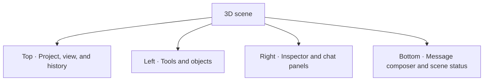
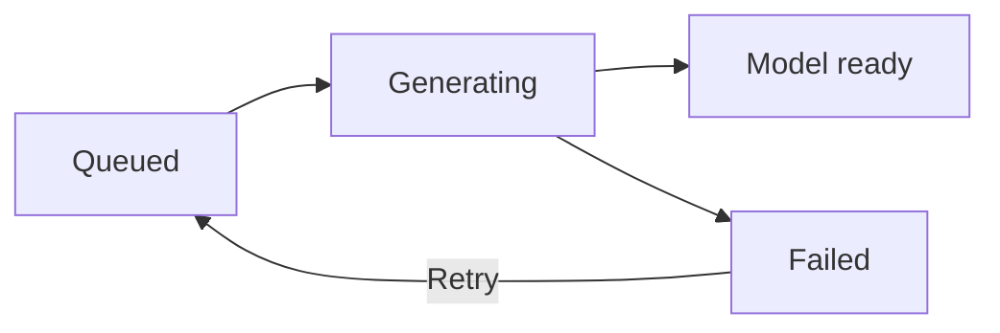

# Roomkit design

The 3D scene fills the viewport. Controls float above it, and the room stays visible as you work.

## Editor layout

Selection brings up the inspector. Keep the same controls and numerical inputs when moving them into a panel. Keep project, job, and capture navigation outside the model canvas controls. The [editor shell](../apps/web/src/editor/editor-shell.tsx) and [layer tokens](../apps/web/src/app/globals.css) define placement and stacking.

## Type and color

| Element | Rule |
| --- | --- |
| Canvas and panels | Warm paper `#f4f1ea`, 1 px borders, 2 px panel corners |
| Text | Ink `#1b2430`, with muted ink for secondary labels |
| Accent | Blueprint blue `#1e50e6` for selection, focus, and active states |
| Titles | Instrument Serif |
| Controls, labels, and measurements | Geist Mono with tabular digits for measurements |

Reuse the [global tokens and type utilities](../apps/web/src/app/globals.css). Use ticks and visible units on dimension lines. Let spacing and alignment group controls.

## Scene feedback

Show pending items at their expected size. Use the object appearance transition when a model arrives. Under reduced motion, use the editor’s reduced-motion path and keep every status available as text. Show progress in Jobs and offer recovery actions there when available.

Orbit frames the layout. Walk mode shows the room at eye level. Snapshots use the current viewport, and the separate photo render can be viewed alongside the snapshot. See the [scene renderer](../apps/web/src/editor/scene/) and [appearance timing](../apps/web/src/editor/generation/appearance-timing.ts) for implementation details.
