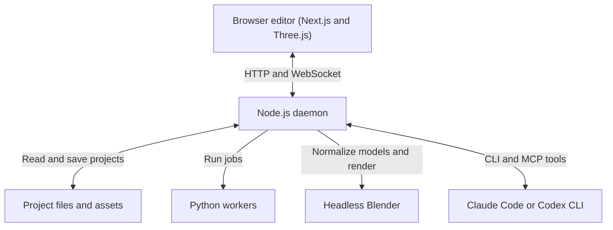
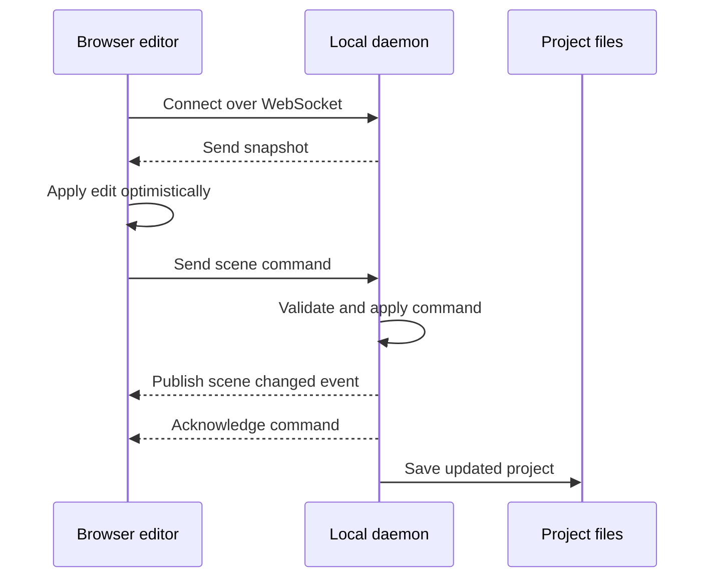
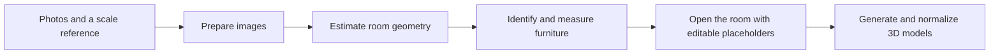

# Roomkit architecture

Roomkit runs on one Mac. The browser renders the editor, the daemon owns project state, and local workers handle image processing and rendering.

## Components

| Location | Responsibility |
| --- | --- |
| [`apps/web`](../apps/web/src/) | Editor, photo capture, chat, and settings |
| [`packages/daemon`](../packages/daemon/src/) | Project storage, HTTP and WebSocket servers, job queues, and worker processes |
| [`packages/shared`](../packages/shared/src/) | Zod schemas, scene commands, and protocol types |
| [`packages/mcp`](../packages/mcp/src/) and [`roles`](../roles/) | Tools and prompts for the agent CLIs |
| [`python/workers`](../python/workers/) and [`blender`](../blender/) | Photo reconstruction, geometry, segmentation, model normalization, and rendering |

## Editing and storage

The [scene schema](../packages/shared/src/scene/scene-schema.ts) contains the room, items, and camera. Distances are in metres and rotations are in radians. Items attach to the floor, a wall, or the ceiling. A pending item holds a job ID until generation produces an asset.

The daemon stores each project as `project.json` alongside photos, assets, and its `.planner` job records. The browser uses HTTP for file uploads and downloads. See the [command schemas](../packages/shared/src/protocol/client-command-schema.ts) and [server messages](../packages/shared/src/protocol/server-message-schema.ts) for the wire format.

## Photo reconstruction

Reconstruction, inventory, and generation have separate queues and report progress to the editor. A project can also start with typed room dimensions, which skips reconstruction. Orbit and walk mode render live in the browser. Photo rendering uses a saved scene and camera view in a separate Blender job.

Roomkit stores projects locally. Agent-assisted features can send prompts or images to the chosen CLI provider. See the [setup guide](../README.md#quick-start) for dependencies and storage paths.
